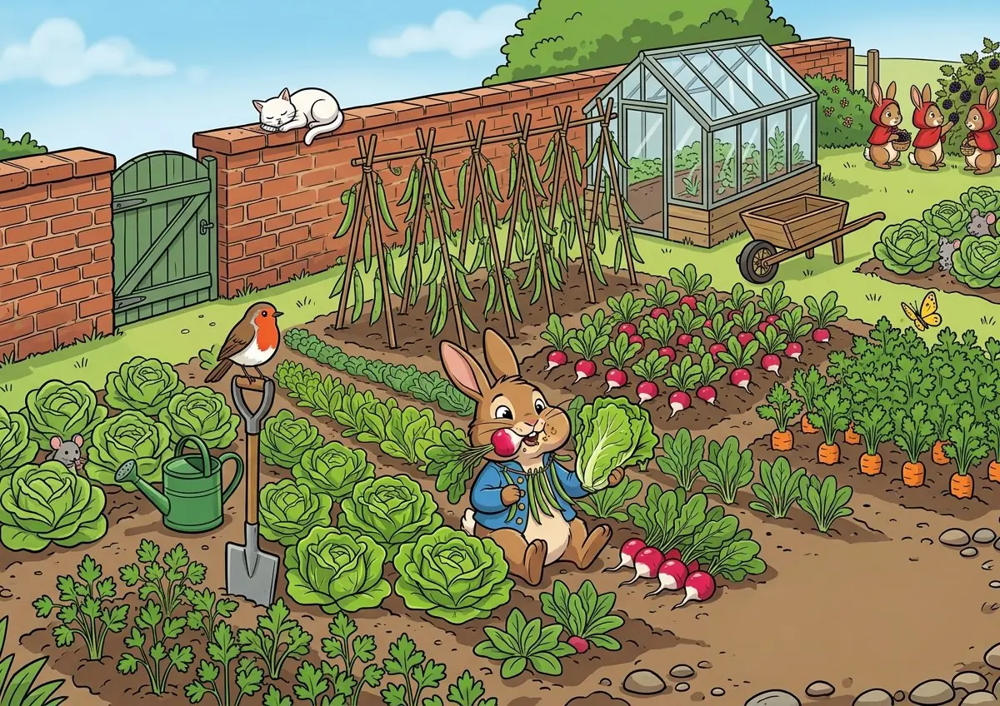
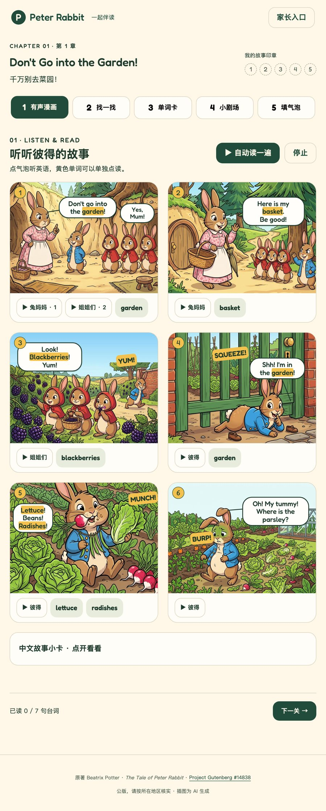
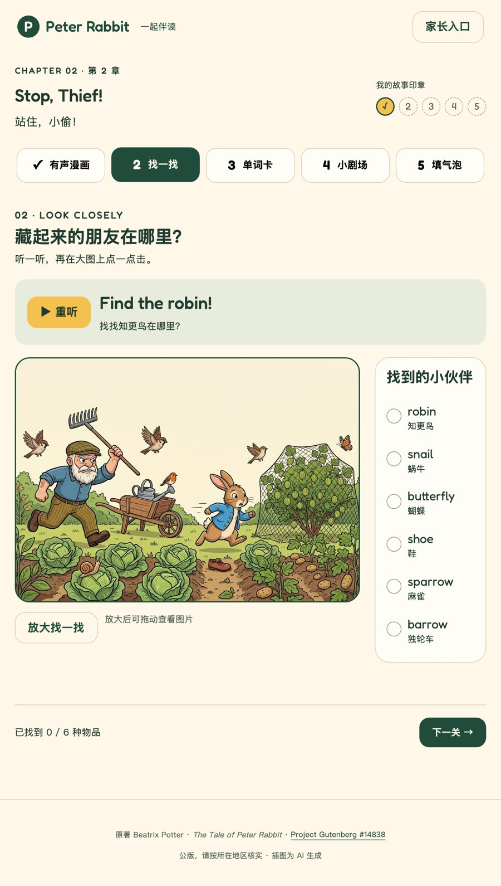

<p align="center"></p>
<h1 align="center">彼得兔互动伴读 · Peter Rabbit Interactive</h1>
<p align="center"><strong>Listen, read, and take the story back to paper.</strong><br>听一句，读一格，把故事带回纸上。</p>
<p align="center">A parent-guided English companion, designed for about 15 minutes per chapter.</p>
<p align="center"><a href="../README.md">简体中文</a> · <a href="英文说明v1.2.md">English</a></p>
<p align="center"><code>Static site</code> · <code>British voices</code> · <code>Five activities</code> · <code>Local progress</code></p>
<p align="center"><a href="#quick-start">Quick start</a> ｜ <a href="#workflow">Activities</a> ｜ <a href="#status">Status</a> ｜ <a href="#docs">Documentation</a></p>
<p align="center"><sub>The cover is an AI-generated illustration supplied by the project owner.</sub></p>

<a id="quick-start"></a>
## Quick start

**[Open the four-chapter companion](https://tuanziding.github.io/peter-rabbit-interactive/)** · [Chapter 1](https://tuanziding.github.io/peter-rabbit-interactive/play/peter-rabbit/chapter.html?n=1) · [Chapter 2](https://tuanziding.github.io/peter-rabbit-interactive/play/peter-rabbit/chapter.html?n=2) · [Chapter 3](https://tuanziding.github.io/peter-rabbit-interactive/play/peter-rabbit/chapter.html?n=3) · [Chapter 4](https://tuanziding.github.io/peter-rabbit-interactive/play/peter-rabbit/chapter.html?n=4)

Read and play together with a parent, then return to paper homework. No installation or account is needed. Tap Start once to unlock audio and turn up the device volume.

| Comic · Actual screenshot | Find it · Actual screenshot |
|---|---|
|  |  |

For local use, download the repository. With Python 3 installed, run from the repository root:

```sh
python3 -m http.server 8817 --bind 0.0.0.0
```

Open [the local bookshelf](http://localhost:8817/play/peter-rabbit/) on the Mac. On an iPad connected to the same Wi-Fi network, open `http://MAC-LAN-IP:8817/play/peter-rabbit/` in Safari. Tap Start once to unlock audio and turn up the device volume.

The site can be hosted on GitHub Pages. When serving the repository root, open `/play/peter-rabbit/`; an Actions artifact can instead publish that subdirectory as a complete site. The root includes .nojekyll and site assets use relative paths. GitHub Pages serves the main branch from the repository root; the root entry redirects to the bookshelf.

<a id="workflow"></a>
## Five activities

**Comic → Find it → Word cards → Read & act → Fill the bubbles → Paper homework**

| Activity | Interaction |
|---|---|
| Comic | Tap a bubble for speech; highlight the whole sentence; tap yellow vocabulary; swipe panels on phones |
| Find it | Listen and locate six object types; zoom and generous touch tolerance |
| Word cards | Flip five cards, play words and examples, then answer five picture questions |
| Read & act | Read ten bilingual lines; choose a character in this chapter; the child's lines are silent until they tap Done |
| Fill the bubbles | Pointer dragging and tap-then-tap both work; plural forms have Chinese hints |

Each activity awards one stamp. Progress is stored only in localStorage on this browser; the parent panel can reset it. A gentle break reminder appears after 15 foreground minutes. There is no microphone access, recording, pronunciation grading, tracking, backend, external CDN, ranking, or streak system.

<a id="status"></a>
## Capability status

| Status | Scope and limitations |
|---|---|
| Implemented | Chapters 1–4, 49 images and 204 offline Kokoro speech files |
| Asset check passed | All media references exist; WebP ≤250 KB and ≤1200px wide; MP3 64 kbps mono |
| Browser verification | 32 complete Chromium/WebKit flows passed across all four chapters; automated WebKit does not replace a real iPad Safari trial |
| Owner feedback | Chapter 1 was reported satisfactory; the owner authorized Chapters 2–4, now ready for a device trial |
| First-version choice | Sentence highlighting; no word-level alignment or speech scoring |

<details><summary><strong>Rebuild and verification</strong></summary>

The extractor parses literal C and S/V data; it never imports or runs the source rendering scripts. Keep the virtual environment and model files outside Git.

```sh
python3 -m venv ~/peter-prep/venv
~/peter-prep/venv/bin/python -m pip install kokoro-onnx soundfile numpy pillow
for chapter in 2 3 4; do
  ~/peter-prep/venv/bin/python tools/extract-chapterv1.1.py --chapter "$chapter" --kit /path/to/peter-rabbit-interactive-kit.zip
  ~/peter-prep/venv/bin/python tools/make-line-audiov1.1.py --chapter "$chapter" --models ~/peter-prep/models
done
~/peter-prep/venv/bin/python tools/checkv1.1.py
```

The original Chapter 1 extractor is retained as extract-chapterv1.0.py. Existing audio is ready to play; synthesis dependencies are only needed to rebuild it. FFmpeg is required. Use the official `kokoro-v1.0.onnx` and `voices-v1.0.bin` files. `--fallback` uses macOS Daniel/Flo; the delivered audio uses Kokoro.

Install Playwright and its Chromium/WebKit browsers, then run `PETER_QA_CHAPTER=2 node tools/browser-checkv1.1.mjs`. Set `PETER_PLAYWRIGHT_MODULE`, `PETER_QA_URL`, or `PETER_QA_OUTPUT` when needed. Set PETER_QA_CHAPTER to 1, 2, 3 and 4 for full coverage. Tests use isolated browser contexts and do not touch the owner's browser progress.

</details>

<a id="docs"></a>
## Documentation and contributions

| Topic | Link |
|---|---|
| Chinese homepage | [简体中文](../README.md) |
| Validation and device trial | [Validation record](验证记录v1.2.md) |
| Sources and rights | [Asset provenance](素材来源v1.2.md) |

Feedback on touch targets, character voices, and the transition to paper exercises is welcome. Do not include a child's name, photograph, or school in public material.

<p align="center"><strong>Peter Rabbit Interactive</strong><br><a href="https://github.com/TUANZIDING">TUANZIDING</a> · Beatrix Potter · Project Gutenberg #14838</p>

Project Gutenberg identifies the original as public domain in the USA; check other jurisdictions. Illustrations were supplied as AI-generated assets. Fredoka is distributed with its SIL OFL license. See the provenance document for remaining publication boundaries.
